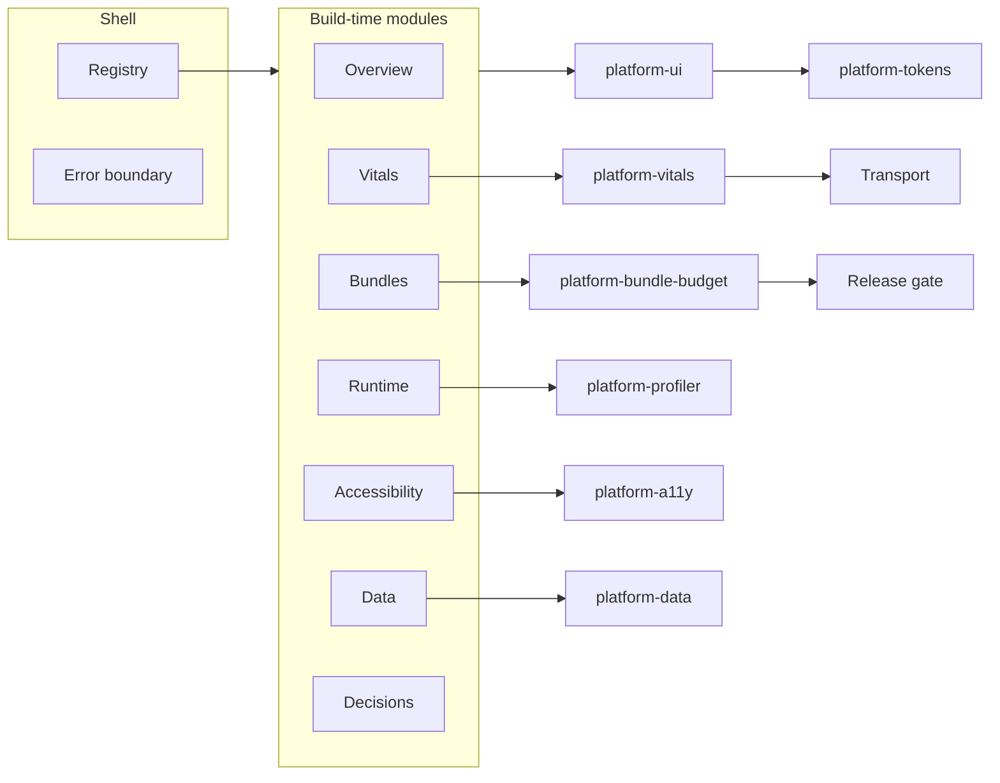

# Architecture

One deployable shell and a set of platform packages. Teams own modules. The platform team owns the shell, the tokens, the metric math, and the gates.

## Composition

Default: build-time registration and per-module chunks. One React major. One token set. Bundle stats can see the whole graph.

Escape hatch: `loadRemoteModule` with a timeout and a structural contract. Failure is a result, not a hung shell. See [ADR 0001](adr/0001-modular-frontend.md) and [ADR 0007](adr/0007-remote-modules.md).

## Measurement

| Question | Owner | Gate |
| --- | --- | --- |
| Is the route within its gzip budget? | `platform-bundle-budget` | Error fails CI. Missing policy fails CI. |
| Is p75 LCP, INP, and CLS inside the budget? | `platform-vitals` | Missing samples fail a release gate. |
| Is the main thread blocking? | `platform-profiler` | Lab evidence. Field sampling is an operations choice. |
| Did the scan yield the thread? | `platform-profiler` | A tick can land between slices. The same scan on one turn records zero ticks. |
| Can a screen be named, labelled, and ordered? | `platform-a11y` | The shell test audits every module. Both palettes pass contrast. |
| Did focus follow the module change? | Shell | The new heading is focused after the first load. |
| Does the address bar match the module route? | Shell | Title, path, and canonical update with the module. |
| Which response is allowed to land? | `platform-data` | Newer generation wins. Abort restores the previous record. |
| Did the other tab hear it? | `platform-data` | A landed entry is posted on a BroadcastChannel. An older generation is ignored. |
| How long did the page's JavaScript take to import? | Shell | Focus starts the import. `performance.measure` records it. |
| Did a failed save put the old value back? | `platform-data` | The note is shown immediately. A rejected write restores the previous note. |
| Is a poll still in flight? | `platform-data` | The next tick is skipped. A hidden document aborts it. An error lengthens the wait. |
| Did the worker answer `/api/pulse`? | `public/sw.js` | The Data page fetches that URL only. Cache Storage keeps the body. Resource timing records the request. |
| Which palette is on the document? | `platform-tokens` | `data-theme` selects light or dark. `system` follows the OS. |
| Is this build inside the route budgets? | Vite manifest check | `npm run check:build` after `npm run build`. |

## What is intentionally not here

- A second copy of React loaded at runtime.
- A vendor RUM SDK. The collector accepts any transport.
- A claim that the in-house accessibility rules are a WCAG audit.
- Module Federation, single-spa, or iframes as the default composition model.
- A service worker for the catalog or for offline pages. The one worker answers `GET /api/pulse` only. Other tabs still share a landed cache entry through `BroadcastChannel`.
- Prerendered HTML per route. A crawler that does not run JavaScript gets `index.html`.
